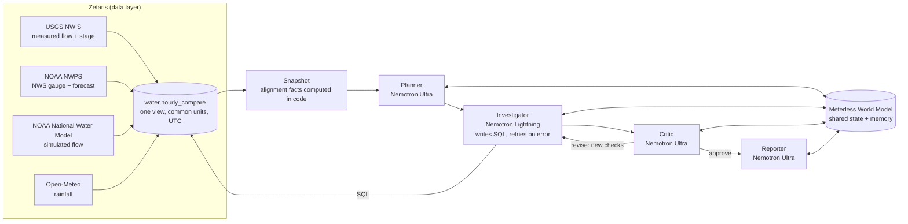

# RiverTruth

**An agent team that works out why river data sources disagree, and shows its evidence.**

When a river rises, a flood forecaster or emergency manager looks at several sources at once: the USGS gauge, the NOAA National Water Model, the NWS river gauge, and rainfall. They often disagree, sometimes by a factor of 25. Working out *why* (a dam release? a model that has not caught up? two gauges converting water level to flow differently? rain?) takes an expert hours of pulling data from four agencies in four formats.

RiverTruth does that investigation in about two minutes. A planner proposes competing explanations, an investigator tests each one with SQL across the four agencies' data in Zetaris, a critic challenges the findings and sends work back, and a reporter writes a cited answer. Every claim traces to a query result, and every model call carries a receipt showing which NVIDIA Nemotron model answered.

Built for the **GenAI.Works Open Agent Hackathon 2026**, Track 1: *Solving Fragmented Intelligence*.

---

## What it found on real data

Black Warrior River at Tuscaloosa and Northport, Alabama, October 16–23, 2026:

- **Every evening at 9 PM CDT, for seven days running, flow at the USGS Northport gauge jumped from ~150 cfs to 5,000–8,000 cfs, with zero rain.** That is the signature of scheduled hydropower releases (hydropeaking) from Holt Lock and Dam upstream.
- **The National Water Model caught the pulse, but an hour late**: on Oct 22 USGS peaked at 5,640 cfs at 9 PM, the model at 5,516 cfs at 10 PM. At the moment of the surge the model still showed ~170 cfs, which is why a forecaster looking at both live sees a 25× disagreement.
- **The NWS gauge at Oliver Lock and Dam, 1 km downstream, barely moved (≈1,000–1,500 cfs)**, even though it reports exactly the same tailwater stage as a USGS gauge there. The two agencies' flows sit at different hydraulic points (the pool above the dam vs. the tailwater below it), and the agent tests whether the dam re-regulates the pulses with a daily mass balance.

Across seven Alabama gauges (scan of Oct 23, 2026), **the big disagreements sit below dams that release water in pulses**: at Bevill Lock and Dam (Tombigbee) the three flows typically differ by 7×, and on the Black Warrior by 3× (41× at the worst hour). On the free-flowing Cahaba, Flint and Pea rivers they agree to within 0–20%, and so does the Alabama River at Claiborne Dam, which shows that a dam alone is not the cause; how it is operated is.

Full reports, with the SQL behind every claim, are in [`output_examples/`](output_examples/).

---

## For anyone heading to a river: the map and the River check

The web app opens on a map of **every NWS river gauge in the US** (about 13,000), coloured by flood status. NOAA's gauge catalog is registered in Zetaris by region and read with SQL. Pick a gauge (or use your location) and press **Check this river**. In a few seconds you get:

- **Which number to trust here** (USGS measured flow when there is one, otherwise the NWS gauge, otherwise the model) and how the other sources compare;
- **What the river has been doing** that a forecast won't show: a daily surge at a fixed hour (e.g. a hydropower release), a regular daily rise, or a rise after rain, and whether the other sources showed it;
- **Right now**, compared with this week, in the gauge's own local time;
- a flood banner whenever the NWS lists the gauge at action, minor, moderate or major flood stage.

Every number is computed in code ([`agent/rivercheck.py`](agent/rivercheck.py)); a fast Nemotron model only words it, a number guard replaces any sentence with a number not in the facts, and flood advice is always written by code. Gauges that report water level only (tide, lake and many lock gauges) get a level check and a level chart. The patterns found are stored on the gauge in the World Model. **Investigate in depth** then runs the full agent team on that gauge.

## Any river, not just one

The Black Warrior is the deeply studied example, but RiverTruth works on any US river gauge with an NWS code:

- **Source Scout** ([`agent/scout.py`](agent/scout.py)): give it a gauge code such as `CKLA1`. It registers the gauge's NOAA record in Zetaris, reads with SQL which USGS site and National Water Model reach belong to it, then registers those sources plus rainfall as Zetaris REST tables and builds one hourly view in common units (`water.hc_<code>`). The gauge and its upstream/downstream neighbours go into the World Model, so the agents' memory grows with every river investigated.
- **Where do the sources disagree right now?** ([`agent/radar.py`](agent/radar.py)): scans an Alabama watch list (dam-regulated and free-flowing rivers), and ranks them by how far apart USGS, the National Water Model and the NWS are over the last 48 hours (highest flow ÷ lowest, per hour). Pick a row in the web app and the agent team investigates that river.

```bash
python3 -m agent.main --site CKLA1     # investigate any gauge from the terminal
python3 -m agent.radar                 # print the ranking
```

Every report opens with two plain-language sentences for the public, and the web app explains the terms (cfs, hydropeaking, tailwater, …) on hover.

---

## How it works



**The loop is not a pipeline.** The critic reads every finding against the evidence and the computed facts, can mark a hypothesis refuted, flag a wrong unit or time zone, and send new checks back to the investigator. A failed SQL query is retried with the error message. Finally a **fact-checker** (Nemotron Lightning) compares the finished report, including the plain-language summary, with the facts computed in code and proposes exact-text corrections; the code applies at most three non-destructive ones and lists them under "Fact-check".

**Confidence follows the critic.** The critic usually asks for more evidence, and the loop stops after a fixed number of rounds. When the critic has not approved, the report's confidence is capped at Medium, its open points and unrun checks are listed under "What the critic still questioned", and nothing from that run is stored as memory for later runs.

**Guardrails in code, not just in prompts.**
- SQL written by a model passes a read-only gate ([`agent/sqlguard.py`](agent/sqlguard.py)): one `SELECT`/`WITH` statement over the river's own view, no DDL/DML, no comments, no other tables, `LIMIT` ≤ 200. A rejected query goes back to the model with the reason. An optional separate read-only Zetaris key (`ZETARIS_AGENT_API_KEY`) is used for these queries.
- Every model reply is validated ([`agent/schemas.py`](agent/schemas.py)): ids and enums are enforced, broken items dropped, one repair attempt, then a safe default. JSON roles run at temperature 0.
- Every run has a total deadline and a Cancel button, and is always closed in the World Model (`complete`, `timed_out`, `cancelled` or `failed`).
- Report rules ([`agent/guards.py`](agent/guards.py)) remove places from other rivers, "0 cfs" for sources with no data and misread flood stages; critic notes that mention another river's gauge are dropped before the reporter sees them.
- The local web server answers only `localhost`, refuses other websites (Origin check, JSON only, per-session token) and rejects malformed or oversized requests.

**The Meterless World Model is the agents' shared world.** Hypotheses, checks, evidence and findings are written to it with provenance (which agent, when, which run). The investigator and critic both write a hypothesis's status; the most recent claim wins and the full history is kept (`planner:open → investigator:refuted → critic:unclear → critic:refuted`). The reporter reads the final status from the World Model. After each run, the conclusions are stored on the gauge itself, so the next investigation starts from what earlier ones learned, and the critic is told to re-verify that memory against today's data.

**Time alignment is done in code, not by the model.** Comparing a 15-minute USGS series in local time with an hourly UTC model that publishes two days late is exactly where language models slip. A snapshot computes the facts (each day's peak, the model's lag, where a source simply has no data, daily mass balance) and the critic treats them as ground truth.

---

## Sponsor technology

### Zetaris: the data layer
Four public agencies' REST APIs are registered in Zetaris as Lightning REST tables, cached, and flattened into SQL views ([`sql/01_register_sources.sql`](sql/01_register_sources.sql)). A single unified view, `water.hourly_compare` ([`sql/03_hourly_compare.sql`](sql/03_hourly_compare.sql)), aligns all four to UTC hours and common units (cfs, ft, mm), turning kcfs into cfs and local-offset timestamps into UTC. Every piece of evidence the agents use is a SQL query against Zetaris over its REST API ([`agent/zetaris.py`](agent/zetaris.py)). `scripts/refresh_data.py` re-fetches all sources.

### Meterless Engine: World Model (with test)
[`world_model/`](world_model/) is a Python implementation of the Meterless World Model spec: content-addressed stable IDs, an event-sourced single-writer store with an ordered audit log, mandatory provenance on every write, idempotent ingest, bitemporal superseding edges, banded entity resolution (0.85 / 0.82), and fact conflict policies, persisted to disk. [`agent/memory.py`](agent/memory.py) wires RiverTruth onto it (river topology, per-run case state, cross-run memory).

**Test:** `python3 scripts/world_model_conformance.py` runs **11 checks, all passing**: a check-for-check port of the 8 official Meterless conformance checks (stable IDs, merge bands, provenance, idempotency, bitemporal edges, audit order), plus three for what RiverTruth relies on: two agents writing concurrently without losing updates, persistence across a restart, and the critic overriding the investigator with history kept. Also runnable with `python3 -m unittest discover -s tests -t .`.

### Meterless Nightshift: primary AI provider
Every model call goes through Nightshift's OpenAI-compatible Runtime ([`agent/llm.py`](agent/llm.py)) with the `meterless-app` and `meterless-scope` headers, streamed (which keeps long reasoning calls inside the gateway's timeout). Each call logs Nightshift's receipt: `routed_model` and `decision_id`.

### NVIDIA Nemotron
| Role | Model | Why |
|---|---|---|
| Investigator (SQL + interpretation, many calls) | `nvidia/nemotron-3.5-lightning-30b-a3b` | Fast, strong at structured tool-style output |
| Planner, Critic, Reporter (judgment) | `nvidia/nemotron-3-ultra-550b-a55b` | NVIDIA's largest model for the reasoning-heavy steps |

Reasoning settings were measured per model ([`scripts/probe_thinking.py`](scripts/probe_thinking.py)): `/no_think` for Lightning, `enable_thinking=false` for Ultra. The UI's "Which model answered each step" panel and every `logs/run_*.jsonl` show the Nemotron model that served each request.

### Cursor
Cursor (with Space XAI) was used as an AI coding tool during development.

---

## Run it

### Fastest: sample mode (no services, no credentials)
Replays recorded real investigations from `data/sample/`.

```bash
python3 -m venv .venv && source .venv/bin/activate
pip install -r requirements.txt
bash scripts/replay_samples.sh                 # runs the three test cases in the terminal
SAMPLE_MODE=true WORLD_DIR=$(mktemp -d) python3 -m web.server   # or the web app: http://localhost:8765
# In sample mode the map, the recorded gauges' River checks and charts, and the three investigations all work offline
# (the map background tiles still come from OpenStreetMap).
```

### Live
Requires Zetaris running locally (Docker), Meterless Nightshift with an NVIDIA provider and a Nemotron lane, and Python 3.11+.

```bash
cp .env.example .env          # fill in ZETARIS_API_KEY, METERLESS_BASE_URL, METERLESS_RUNTIME_TOKEN
python3 smoke_test.py         # checks Zetaris SQL + both Nemotron models through Nightshift
python3 scripts/run_sql.py sql/01_register_sources.sql
python3 scripts/run_sql.py sql/01b_fix_nwm.sql
python3 scripts/run_sql.py sql/01c_nwm_view.sql
python3 scripts/run_sql.py sql/03_hourly_compare.sql
python3 -m web.server         # http://localhost:8765
# or the terminal:
python3 -m agent.main --case 1          # also --case 2, --case 3, --list, or any question in quotes
```

### Test cases
| # | Question | What it exercises |
|---|---|---|
| 1 | Why did USGS, the NWM and the NWS disagree on the evening of Oct 22? | Live event, three sources, timing |
| 2 | The NWS gauge reads higher than USGS 1 km upstream most of the time. Which to trust, and why? | Shared sensor, rating differences, mass balance |
| 3 | Does the National Water Model capture the daily surges, how late and how accurately? | Model lag vs. missing data |

Outputs: `output_examples/run_*_report.md` (answer + every SQL query and result), `output_examples/run_*_case.json` (full case state), `logs/run_*.jsonl` (every agent step, SQL query and model call with its receipt).

---

## Tests

```bash
bash scripts/run_tests.sh      # exits non-zero if anything fails
```

Runs everything without Zetaris, Nightshift or the internet. [`tests/fakes.py`](tests/fakes.py) provides a SQL-aware fake Zetaris (it honours `ORDER BY`/`LIMIT`, only answers a scouted view after its `CREATE VIEW`, and can return NOAA's HTTP 429), a fake model, and one gauge of every kind the app meets: the flagship, a gauge with all sources, a USGS site that reports stage only, a gauge with no USGS site or model reach, a tide gauge with a month of history, and a gauge with no data.

| Level | File | What it proves |
|---|---|---|
| Conformance | `scripts/world_model_conformance.py` | Meterless World Model spec, 11 checks |
| Unit | `tests/test_rivercheck.py` | River check facts: surge vs daily rise, which source to trust, recent rise after rain, dry streams, level-only gauges, number guard, flood advice always written by code, memory |
| Unit | `tests/test_guards_scout_sites.py` | Report rules, Source Scout SQL, local time zones, US catalog regions and 429 splitting, fact-check limits |
| Regression | `tests/test_latest_rows.py` | Every reading comes from the newest hours, however long a gauge's history |
| Integration | `tests/test_integration_server.py` | The real web server: every gauge kind gets a check, a chart of its newest data, memory and an investigation; the whole-US map survives rate limits |
| Failure paths | `tests/test_model_replies.py`, `tests/test_run_lifecycle.py` | Malformed model replies, critic revise loop, SQL retry, fallback to the fast model, deadline, cancel, crash closes the run |
| Security | `tests/test_sqlguard.py`, `tests/test_server_security.py` | Read-only SQL gate (incl. a model-written `DROP` in a full run), CSRF, DNS rebinding, bad bodies, no crashed server threads |
| Report integrity | `tests/test_report_integrity.py` | Confidence capped without critic approval, open points listed, public summary fact-checked, cross-run leak guard |
| Hygiene | `tests/test_defaults_hygiene.py`, `tests/test_runner.py` | No secrets or personal data in committed files, safe defaults, the runner fails on a failing test, broken views rebuilt |
| Browser | `tests/test_browser.py` | Headless Chromium: the page looks the same for every gauge kind and never leaves the previous gauge on screen (skipped if Playwright is not installed) |

Changes are made test-first: a failing test that shows the problem, then the fix.

## Data sources

| Source | What | Access | Terms |
|---|---|---|---|
| USGS NWIS instantaneous values | Discharge and gage height, sites 02465000 and 02465005 | `waterservices.usgs.gov`, no key | US public domain |
| NOAA NWPS | NWS gauge TODA1 metadata, observed and forecast stage/flow | `api.water.noaa.gov/nwps/v1`, no key | US public domain |
| NOAA National Water Model (via NWPS) | Reach 18229923 analysis streamflow | `api.water.noaa.gov/nwps/v1/reaches`, no key | US public domain |
| Open-Meteo | Hourly precipitation at the gauge | `api.open-meteo.com`, no key | CC BY 4.0 |

No personal or confidential data is used.

## Limitations
- The flagship reach has hand-written background notes; other gauges get generic notes, so their explanations are less specific. Gauges without a linked USGS site or National Water Model reach cannot be compared and are reported as such.
- No dam operation records are publicly available through these APIs, so hydropower releases are inferred from the flow pattern (same hour daily, zero rain, stage rise), and the report says so.
- The NWM analysis series via NWPS covers about two days, so model behavior can only be judged inside that window (the snapshot marks everything outside it as "no data").
- USGS data are provisional.

## Repository layout
```
agent/          the agent team: orchestrator, roles and prompts, snapshot, Nightshift client, Zetaris client, World Model wiring
world_model/    Meterless World Model engine (Python implementation)
web/            web app (standard library server + one HTML page, no external dependencies)
sql/            Zetaris source registrations and the unified view
scripts/        smoke test, conformance test, data refresh, record/replay, provider probes
tests/          World Model conformance tests
data/sample/    recorded runs for sample mode
output_examples/ reports from real runs
```

## Pre-existing components
None. All code was written during the build window (from Oct 22, 2026). Open-source dependencies: `openai`, `python-dotenv`, `requests` (Python); [Leaflet](https://leafletjs.com) 1.9.4 for the map, loaded from cdnjs, with OpenStreetMap tiles. Tests use only the Python standard library (plus Playwright, optional, for the browser tests).

## License
MIT
